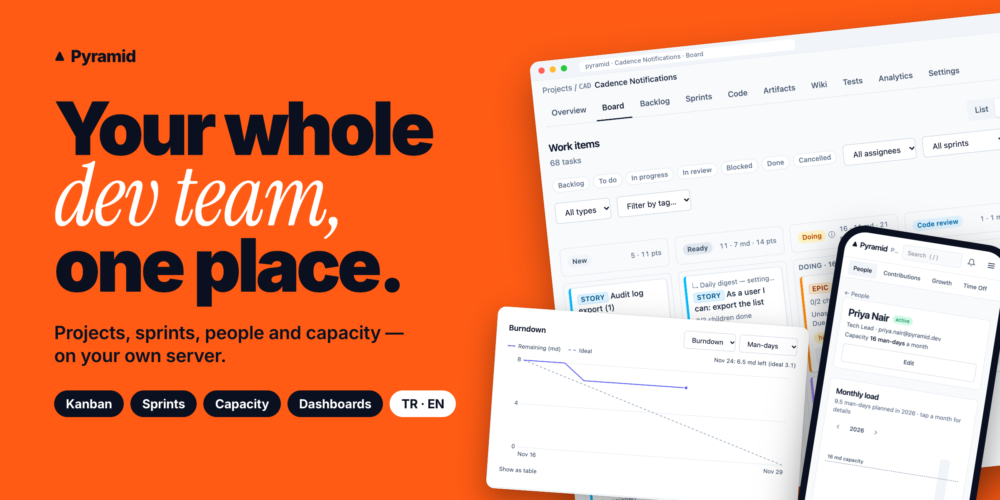
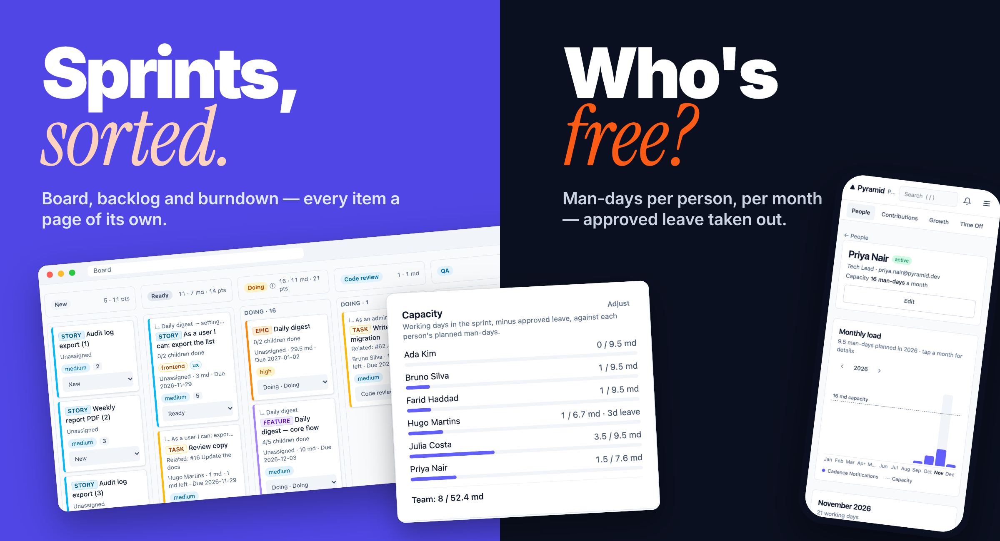
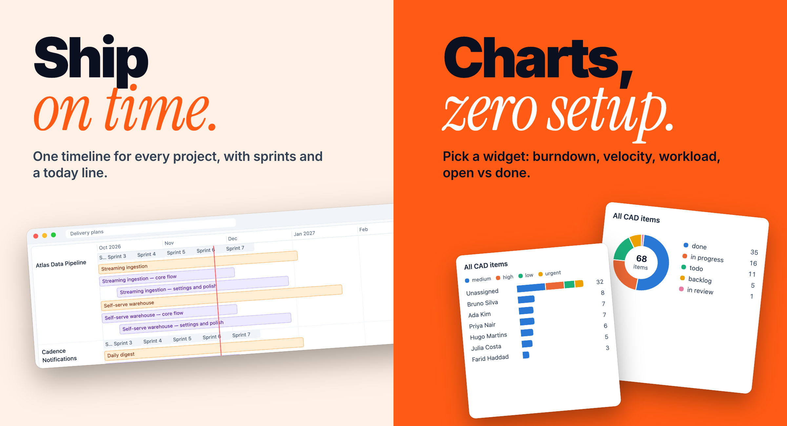
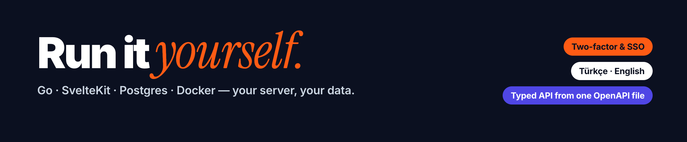

<p align="center">
  
</p>

<p align="center">
  <b>Pyramid</b> runs a software department in one self-hosted app:<br>
  projects and sprints, people and their capacity, dashboards and delivery plans — in Turkish or English.
</p>

<p align="center">
  <a href="#quick-start"><b>Quick start</b></a> ·
  <a href="#whats-inside"><b>What's inside</b></a> ·
  <a href="#architecture"><b>Architecture</b></a>
</p>

<p align="center">
  
  
  
</p>

## What's inside

| | |
|---|---|
| **Projects** | Board and list views, backlog levels with a forecast, sprints with burndown, burnup and team capacity, milestones, item pages with Markdown, pasted screenshots, comments and @mentions |
| **People** | Monthly load per person in man-days, time off that lowers capacity, contributions, growth goals |
| **Planning** | Delivery plans across projects, saved queries with a query language, dashboards built from chart widgets |
| **Engineering** | Wiki, test plans, repos and pipelines, artifacts, Git linking, webhooks, Excel import and export |
| **Admin** | Accounts and per-project permissions, teams, process templates and work item rules, two-factor sign-in, OpenID Connect SSO, API tokens, audit log |
| **Everywhere** | Full-text search, notifications and follows, Turkish and English interface, works on phones |

Under the hood it is a monorepo with a Go backend and a Svelte frontend that share a single, generated type contract.

## Architecture

```
┌──────────────────────┐        generates        ┌──────────────────────┐
│  Svelte frontend      │  ◀───────────────────   │  openapi/openapi.yaml │
│  (SvelteKit 2,        │   openapi-typescript     │  the SINGLE source    │
│   Svelte 5, Tailwind) │                          │  of truth for the API │
└──────────────────────┘                          └──────────┬───────────┘
        ▲  typed fetch (openapi-fetch)                        │ generates
        │                                                     │ oapi-codegen
        ▼                                          ┌──────────▼───────────┐
   HTTP :5173 ───────────────────────────────────▶│  Go backend (Gin,     │
                                                   │  GORM) → Postgres     │
                                                   └──────────────────────┘
```

The API contract lives in `openapi/openapi.yaml`. Both sides generate their types from it, so a change to a field, enum, or endpoint flows to the Go server **and** the TypeScript client from one edit — the two ends of the wire cannot silently drift apart. The database shape lives in `db/schema.sql` and the GORM models mirror it.

## Repository layout

```
pyramid/
├── openapi/openapi.yaml        # API contract — single source of truth
├── db/
│   └── schema.sql              # PostgreSQL schema (32 tables, 6 modules)
├── docs/SCHEMA.md              # Data-model overview
├── backend/                    # Go + Gin + GORM
│   ├── cmd/server/main.go      # Entry point
│   ├── internal/
│   │   ├── api/                # Generated DTOs (types.gen.go) + enums
│   │   ├── config/             # Env-based configuration
│   │   ├── database/           # GORM connection
│   │   ├── handlers/           # Gin handlers, one file per resource
│   │   └── models/             # GORM models + DTO conversion
│   └── oapi-codegen.yaml       # Go type generation config
├── frontend/                   # SvelteKit 2 + Svelte 5 + Tailwind v4
│   └── src/
│       ├── lib/api/            # schema.d.ts (generated) + typed client
│       └── routes/             # Pages
└── Makefile                    # generate / setup / dev / build
```

## Prerequisites

- **Go 1.25+** (developed against Go 1.27)
- **Node 20+** and npm
- **PostgreSQL 14+**

## Quick start

```bash
# 1. Install dependencies (Go modules + npm packages)
make setup

# 2. Create the database and load the schema
createdb pyramid
make db-schema            # applies db/schema.sql

# 3. (optional) regenerate types from the contract
make generate

# 4. Run the two dev servers in separate terminals
make dev-backend          # Go API  → http://localhost:8080
make dev-frontend         # Svelte  → http://localhost:5173
```

Open http://localhost:5173 — the People page calls `GET /api/v1/people` on the Go API using the generated, fully-typed client.

Configuration is via environment variables; copy `backend/.env.example` and `frontend/.env.example` to `.env` and adjust as needed.

## The type pipeline

`make generate` runs two generators against `openapi/openapi.yaml`:

- **Backend** — `oapi-codegen` writes `backend/internal/api/types.gen.go` (Go structs + enum constants).
- **Frontend** — `openapi-typescript` writes `frontend/src/lib/api/schema.d.ts` (TS `paths`/`components`), consumed by the `openapi-fetch` client in `frontend/src/lib/api/client.ts`.

Add a field to a schema in the contract, run `make generate`, and both sides update together. The enums in the contract mirror the Postgres enum types in `db/schema.sql`.
